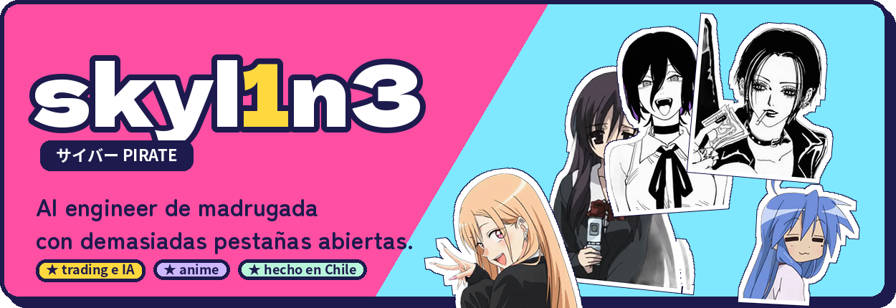
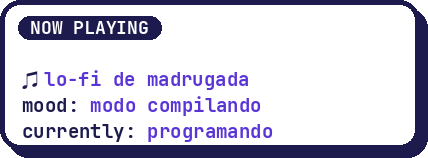

- **Jorge** ★ a.k.a. **skyl1n3** — AI engineer de madrugada.
- Santiago, Chile 🇨🇱 · escribo código, leo velas japonesas y suelto cosas útiles al agua.
- Armo un equipo de **30+ agentes** que planifican, programan, prueban y se auditan entre ellos.
- Fuera de horario: anime en bucle, cyber‑Y2K y café a las 3 a.m.

 

- ★ [**skyl1n3.online**](https://skyl1n3.online) — servicios abiertos y un kit *(próximamente)*
- ★ una mascota anime 3D que explica tecnología, IA y trading
- ★ un PR por tarea, auditado antes de entrar
- ★ estudiando 日本語 e inglés, un kanji a la vez

 

<i>“En un mundo de simulaciones, la autenticidad es el único código que no se puede replicar.”</i> 
pasa ♡ · mira lo que armé · y llévate lo que te sirva  

