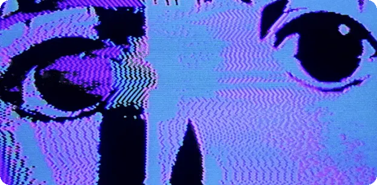

  

- Name: **Jorge** ✦ a.k.a. **skyl1n3**
- From: **Santiago, Chile** 🇨🇱
- Class: **AI Engineer** · Netrunner · Market Ronin
- Guild: **30+ agents** that plan, code, test & audit each other
- Off the clock: anime, cyber‑Y2K, lo‑fi at 3 a.m., too much coffee

 

  

- ✦ [**skyl1n3.online**](https://skyl1n3.online) — public services & an open kit *(wip)*
- ✦ a VTuber‑style mascot explaining tech, AI & markets — *coming soon…*
- ✦ agents shipping one PR per task, audited before merge
- ✦ learning 日本語 & English, one kanji at a time

 

  

      

 

  

<i>“En un mundo de simulaciones, la autenticidad es el único código que no se puede replicar.”</i> — skyl1n3 Ｓｈｉｎｋａｎｓｅｎ　Ｐｒｏｔｏｃｏｌ　ラ゜ホ

  

<i>thanks for stopping by, netrunner — have a lovely day</i> (ﾉ◕ヮ◕)ﾉ*:･ﾟ✧  

